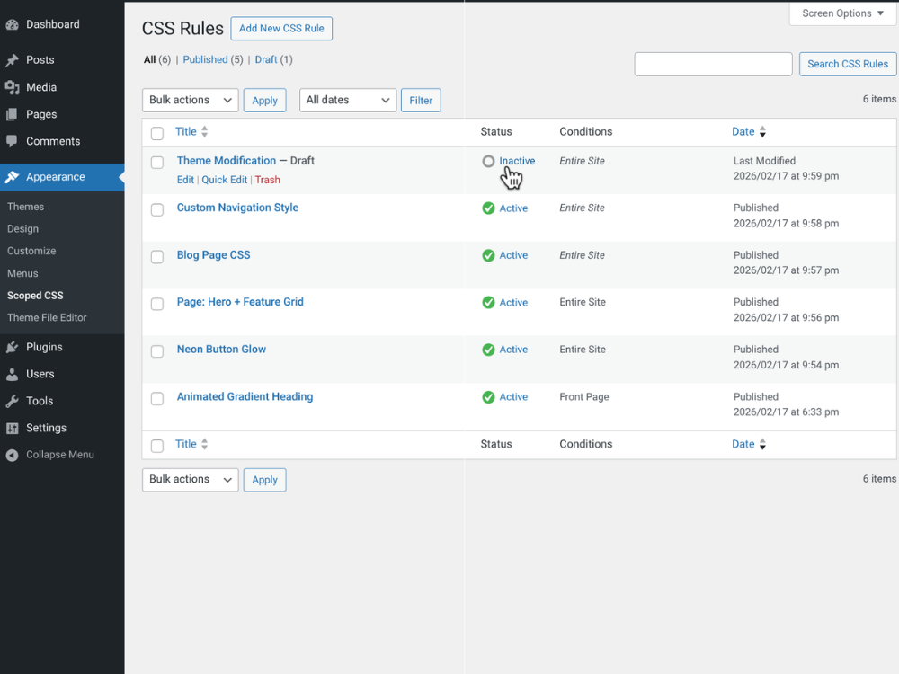
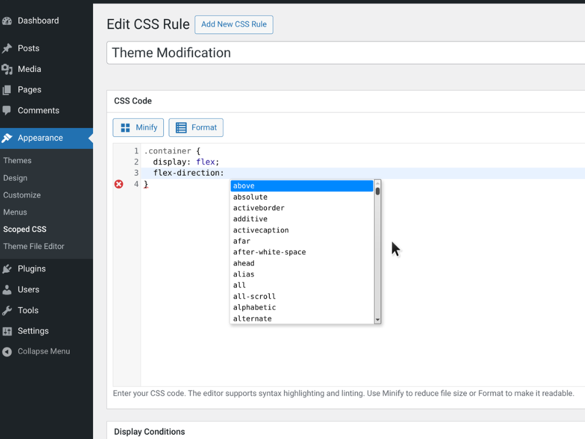
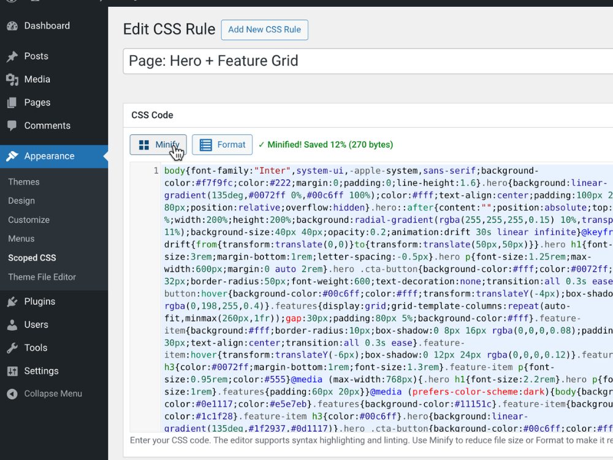
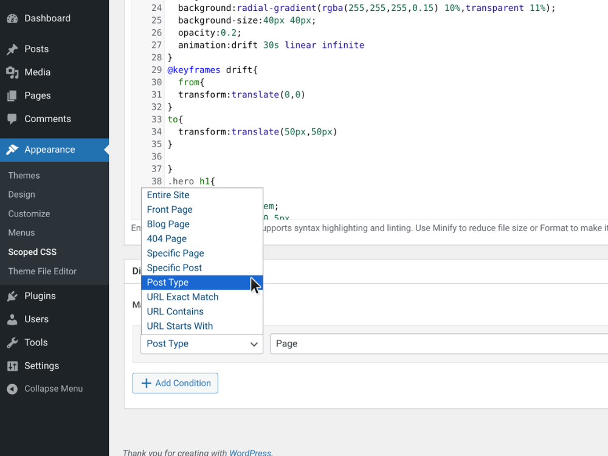

# Scoped CSS

[](https://wordpress.org/)
[](https://php.net/)
[](LICENSE)
[](https://github.com/Sulaiman-Dauda/Scoped-CSS/releases)

**A lightweight conditional CSS manager for WordPress** — Load custom CSS based on page, post, or URL conditions.

---

## Table of Contents

- [Features](#features)
- [Screenshots](#screenshots)
- [Installation](#installation)
- [Usage](#usage)
- [Display Conditions](#display-conditions)
- [WP-CLI Commands](#wp-cli-commands)
- [FAQ](#faq)
- [Contributing](#contributing)
- [Changelog](#changelog)
- [License](#license)

---

## Features

Unlike traditional custom CSS plugins that apply styles globally, Scoped CSS lets you target specific pages, posts, post types, or URLs.

- **Unlimited CSS Rules** – Create as many CSS rules as you need
- **Conditional Loading** – Load CSS only where it's needed
- **CodeMirror Editor** – Syntax highlighting and error checking
- **CSS Minify/Format** – One-click minification and formatting
- **Performance Optimized** – No frontend JavaScript, cached queries
- **Native WordPress UI** – Clean, familiar admin interface
- **Secure** – Proper capability checks and sanitization
- **WP-CLI Support** – Manage rules from the command line
- **Multisite Compatible** – Each site gets its own CSS rules

### Use Cases

- Add custom styles to specific landing pages
- Override theme styles on certain post types
- Apply promotional banners only to specific URLs
- Fix layout issues on individual pages without affecting the rest of the site

---

## Screenshots

<table>
  <tr>
    <td align="center" width="50%">
      <br />
      <strong>Rules Overview</strong><br />
      <sub>List view with status, targeting conditions, and quick actions</sub>
    </td>
    <td align="center" width="50%">
      <br />
      <strong>CSS Editor</strong><br />
      <sub>Syntax highlighting, linting, and code completion</sub>
    </td>
  </tr>
  <tr>
    <td align="center" width="50%">
      <br />
      <strong>One-Click Minify</strong><br />
      <sub>Optimize rule output directly from the editor</sub>
    </td>
    <td align="center" width="50%">
      <br />
      <strong>Conditional Rendering</strong><br />
      <sub>Page-level styles applied based on scoped rules</sub>
    </td>
  </tr>
</table>

---

## Installation

### Manual Installation (GitHub)

1. Download the [latest release](https://github.com/Sulaiman-Dauda/Scoped-CSS/releases/latest) (`.zip` file)
2. In WordPress, go to **Plugins → Add New → Upload Plugin**
3. Upload the downloaded `.zip` file and click **Install Now**
4. Activate the plugin
5. Navigate to **Appearance → Scoped CSS** to create your first rule

### Via Git

```bash
cd /path/to/wordpress/wp-content/plugins/
git clone https://github.com/Sulaiman-Dauda/Scoped-CSS.git scoped-css
```

Then activate from **Plugins** in your WordPress admin.

### Requirements

- WordPress 5.3+
- PHP 7.2+

---

## Usage

1. Go to **Appearance → Scoped CSS**
2. Click **Add New** to create a CSS rule
3. Enter a title (for admin reference)
4. Add your CSS code in the editor
5. Set display conditions to control where the CSS loads
6. Click **Publish** to activate the rule

### Tips

- Use the **Status** toggle in the rules list to quickly enable/disable rules
- Click **Minify** to compress CSS or **Format** to make it readable
- Combine multiple conditions for precise targeting
- Use "URL Contains" for wildcard-like matching

---

## Display Conditions

Each CSS rule can be targeted to:

| Condition       | Description                                        |
| --------------- | -------------------------------------------------- |
| Entire Site     | Apply everywhere                                   |
| Front Page      | Homepage only                                      |
| Blog Page       | Posts listing page                                 |
| 404 Page        | Error page                                         |
| Specific Page   | Target individual pages                            |
| Specific Post   | Target individual posts                            |
| Post Type       | All posts of a type (pages, posts, products, etc.) |
| URL Exact Match | Match exact URL path                               |
| URL Contains    | Match URLs containing a string                     |
| URL Starts With | Match URLs by prefix                               |

> **Pro tip:** Conditions can be combined with **AND/OR** logic for complex targeting.

---

## WP-CLI Commands

Manage your CSS rules from the command line:

```bash
# List all CSS rules
wp scoped-css list

# Enable/disable a rule
wp scoped-css enable <id>
wp scoped-css disable <id>

# Show rule details
wp scoped-css show <id>

# Clear cache
wp scoped-css cache-clear
```

---

## FAQ

### Does this plugin slow down my site?

No. Scoped CSS is optimized for performance:

- Single database query to fetch all rules (cached)
- No JavaScript loaded on the frontend
- Conditions evaluated with native WordPress functions
- Rules cached using WordPress transients

### Can I migrate from Simple Custom CSS?

Yes! When you activate Scoped CSS, any existing CSS from Simple Custom CSS will be automatically migrated to a new rule called "Migrated Global CSS" with "Entire Site" targeting.

### Can I use this alongside other CSS plugins?

Yes. Scoped CSS outputs standard `<style>` tags and doesn't interfere with other plugins.

### Is it multisite compatible?

Yes, each site in a multisite network can have its own CSS rules.

---

## Contributing

Contributions are welcome! Here's how you can help:

1. **Fork** the repository
2. **Create** a feature branch: `git checkout -b feature/my-feature`
3. **Commit** your changes: `git commit -m 'Add my feature'`
4. **Push** to the branch: `git push origin feature/my-feature`
5. **Open** a Pull Request

### Reporting Bugs

Found a bug? [Open an issue](https://github.com/Sulaiman-Dauda/Scoped-CSS/issues/new) with:

- WordPress and PHP versions
- Steps to reproduce
- Expected vs actual behavior

---

## Changelog

### 1.0.0

- Initial release
- Custom Post Type architecture
- Conditional CSS loading with 10 condition types
- CodeMirror editor integration
- CSS minify and format tools
- AND/OR condition logic
- Rate-limited AJAX endpoints
- CSS validation with dangerous pattern detection
- WP-CLI support
- Automatic migration from Simple Custom CSS

---

## License

This project is licensed under the **GPL v2 or later** — see the [LICENSE](LICENSE) file for details.

---

## Author

**Sulaiman Dauda**

- GitHub: [@Sulaiman-Dauda](https://github.com/Sulaiman-Dauda)

---

<p align="center">
  <strong>If you find this plugin useful, consider giving it a ⭐ on GitHub!</strong>
</p>
